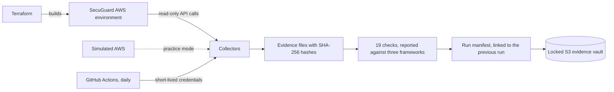

# SecuGuard GRC Engineering

Automated, tamper-evident compliance evidence for PCI DSS, SOC 2, and FedRAMP 20x, collected from a real AWS environment.

SecuGuard is a fictional card-issuing software company invented for this project. It is not a real business.

**New here? Read [MANUAL.md](MANUAL.md).** It walks through everything from a Windows computer with nothing installed to a working system, in plain language.

## The problem this solves

Most compliance evidence is still a screenshot in a folder. A screenshot is out of date the day it is taken, nothing proves it is real, and the same setting gets captured again for every framework that asks about it.

This project gathers evidence the way an engineer would:

| The old way | This project |
|---|---|
| Screenshots taken once a year | Evidence collected from AWS every day |
| Nothing proves a screenshot is unaltered | Every file is hashed, and every run is linked to the one before it |
| Evidence sits in a shared drive anyone can edit | The copy of record is in S3 with Object Lock and cannot be changed or deleted |
| One spreadsheet per framework | Each check is written once and reported against PCI DSS, SOC 2, and FedRAMP 20x |
| A tool that always says "compliant" | Deliberate weaknesses are planted, and tests prove each one is caught |
| Someone has to remember to do it | A scheduled job does it, with no stored AWS keys |

## How it works



## Try it in two minutes

No AWS account needed. Practice mode runs the same collectors and checks against a simulated AWS on your own machine.

```
pip install -e ".[dev]"
secuguard collect --mock
secuguard report
secuguard verify
```

`secuguard report` shows 19 checks and their results under PCI DSS, SOC 2, and FedRAMP 20x. Then edit any file under `evidence/` and run `secuguard verify` again to watch the change get caught.

To look without installing anything, see [examples/sample-report.md](examples/sample-report.md) for the results and [examples/sample-run](examples/sample-run) for the evidence behind them.

## What is built so far

**Stage 1, the evidence foundation**

- A Terraform-built network with three zones tagged by PCI scope: cardholder data environment, connected, and out of scope
- Collectors that ask AWS directly how things are configured
- Hashed evidence records, run manifests, and a hash chain across runs
- An encrypted, versioned S3 evidence vault with Object Lock in compliance mode, which refuses deletion even from an administrator
- Practice mode
- Daily collection from GitHub Actions using OpenID Connect, with no stored AWS keys

**Stage 2, the checks**

- Realistic resources with deliberate, harmless weaknesses: users, a service account, a vendor role, certificates, a load balancer, an encryption key, and a storage bucket
- Eight collectors covering network, encryption keys, storage, sign-in settings, identities, certificates, load balancers, and logging
- 19 checks, each written once and reported against all three frameworks
- Check results sealed and stored with the evidence they were graded from
- `secuguard test-lock`, which proves the vault refuses deletion, and `secuguard verify --vault`, which verifies the copy of record

| Area | Example checks | PCI DSS 4.0.1 | SOC 2 | FedRAMP 20x |
|---|---|---|---|---|
| Network | No admin port open to the internet. The card data zone accepts only in-scope traffic. | 1.3.1, 1.4.1 | CC6.6 | KSI-CNA-RNT |
| Encryption | Keys rotate. Certificates are strong and not expiring. TLS 1.2 or newer. | 3.7.4, 4.2.1 | CC6.7 | KSI-SVC-ASM, KSI-SVC-VCM |
| Identity | MFA for everyone who can sign in. No direct admin rights. No unused keys. | 7.2.1, 8.4.2 | CC6.1, CC6.3 | KSI-IAM-APM, KSI-IAM-ELP |
| Logging | Account activity is recorded. Evidence cannot be altered. | 10.2.1, 10.3.2 | CC7.2 | KSI-MLA-LET, KSI-SVC-VRI |

The mapping of checks to requirements is the author's reading of each framework. It is a starting point for discussion with an assessor, not an assessor's opinion.

## Roadmap

| Stage | Adds |
|---|---|
| 3 | PCI scope drift detection and a preventive check on Terraform changes |
| 4 | FedRAMP 20x Key Security Indicator validation, with AWS Config and Security Hub |
| 5 | Readable report, diagrams, and video walkthrough |

## Cost

About $20 a month in AWS, nearly all of it one load balancer that can be paused with a single setting. `terraform destroy` removes everything.
