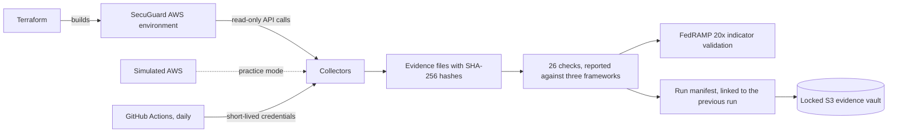

# SecuGuard GRC Engineering

Automated, tamper-evident compliance evidence for PCI DSS, SOC 2, and FedRAMP 20x, collected from a real AWS environment.

SecuGuard is a fictional card-issuing software company invented for this project. It is not a real business.

**New here? Read [MANUAL.md](MANUAL.md).** It walks through everything from a Windows computer with nothing installed to a working system, in plain language.

## The problem this solves

Most compliance evidence is still a screenshot in a folder. A screenshot is out of date the day it is taken, nothing proves it is real, and the same setting gets captured again for every framework that asks about it.

This project gathers evidence the way an engineer would:

| The old way | This project |
|---|---|
| Screenshots taken once a year | Evidence collected from AWS every day |
| Nothing proves a screenshot is unaltered | Every file is hashed, and every run is linked to the one before it |
| Evidence sits in a shared drive anyone can edit | The copy of record is in S3 with Object Lock and cannot be changed or deleted |
| One spreadsheet per framework | Each check is written once and reported against PCI DSS, SOC 2, and FedRAMP 20x |
| A tool that always says "compliant" | Deliberate weaknesses are planted, and tests prove each one is caught |
| Scope confirmed once a year | PCI scope is worked out from the firewall rules on every run and compared with an approved baseline |
| Problems found after they ship | Every proposed change is checked on GitHub, and a risky one cannot be merged |
| Someone has to remember to do it | A scheduled job does it, with no stored AWS keys |

## How it works



## Try it in two minutes

No AWS account needed. Practice mode runs the same collectors and checks against a simulated AWS on your own machine.

```
pip install -e ".[dev]"
secuguard collect --mock
secuguard report
secuguard verify
```

`secuguard report` shows 26 checks and their results under PCI DSS, SOC 2, and FedRAMP 20x, plus the PCI scope of the network and a certificate inventory. `secuguard scope` shows what has drifted from the approved scope. `secuguard ksi` shows where the environment stands against FedRAMP's 46 Key Security Indicators. `secuguard report --html` writes the same results as a web page. Then edit any file under `evidence/` and run `secuguard verify` again to watch the change get caught.

To look without installing anything, see [examples/sample-report.md](examples/sample-report.md) for the results, [examples/sample-ksi-validation.md](examples/sample-ksi-validation.md) for the FedRAMP 20x validation, and [examples/sample-run](examples/sample-run) for the evidence behind them.

## What is built

**Stage 1, the evidence foundation**

- A Terraform-built network with three zones tagged by PCI scope: cardholder data environment, connected, and out of scope
- Collectors that ask AWS directly how things are configured
- Hashed evidence records, run manifests, and a hash chain across runs
- An encrypted, versioned S3 evidence vault with Object Lock in compliance mode, which refuses deletion even from an administrator
- Practice mode
- Daily collection from GitHub Actions using OpenID Connect, with no stored AWS keys

**Stage 2, the checks**

- Realistic resources with deliberate, harmless weaknesses: users, a service account, a vendor role, certificates, a load balancer, an encryption key, and a storage bucket
- Eight collectors covering network, encryption keys, storage, sign-in settings, identities, certificates, load balancers, and logging
- Checks for network, encryption, identity, and logging, each written once and reported against all three frameworks
- Check results sealed and stored with the evidence they were graded from
- `secuguard test-lock`, which proves the vault refuses deletion, and `secuguard verify --vault`, which verifies the copy of record

**Stage 3, scope drift and prevention**

- PCI scope worked out from the firewall rules and compared with each resource's label, so a system labelled out of scope that can reach card data is caught
- An approved scope baseline under version control, and a check that reports anything added, changed, or removed since it was approved
- `secuguard plan-check`, a preventive control that reads a Terraform plan and blocks changes that break a rule before anything reaches AWS
- An exceptions register in which each accepted risk has a reason, an approver, and an expiry date
- A certificate inventory in every report

**Stage 4, monitoring and FedRAMP 20x**

- CloudTrail, network flow logs, AWS Config, and Security Hub, built by Terraform, which fix real findings the earlier stages reported
- A FedRAMP 20x validation that states, for each of FedRAMP's 46 Key Security Indicators, whether it is validated, failing, or not covered, in FedRAMP's own wording
- For every indicator addressed, a plain statement of what the evidence establishes and what it does not
- A machine-readable copy of the validation sealed into every run, listing the evidence files it rests on and their hashes
- The plan check enforced on GitHub: every pull request is planned against the real AWS account with a read-only role, and a ruleset on main refuses to merge one that breaks a rule
- Terraform state kept in an encrypted, versioned S3 bucket

**Stage 5, showing the work**

- `secuguard report --html`, one self-contained web page with the check results, the three framework views, PCI scope, certificates, and the FedRAMP 20x validation. It states at the top whether the evidence behind it verified.
- The same page attached to every daily run on GitHub
- Diagrams, a video script, and this manual

There are 26 checks and 8 plan rules in total. They speak to 16 of the 46 indicators. The other 30 are listed as not covered.

| Area | Example checks | PCI DSS 4.0.1 | SOC 2 | FedRAMP 20x |
|---|---|---|---|---|
| Network | No admin port open to the internet. The card data zone accepts only in-scope traffic. | 1.3.1, 1.4.1 | CC6.6 | KSI-CNA-RNT |
| PCI scope | Every resource has a declared scope. Labels match the firewall rules. Nothing has drifted from the approved baseline. | 12.5.2, 1.2.2 | CC3.4, CC8.1 | KSI-PIY-GIV, KSI-CNA-EIS |
| Encryption | Keys rotate. Certificates are strong, trusted, and not expiring. TLS 1.2 or newer. | 3.7.4, 4.2.1 | CC6.7 | KSI-SVC-ASM, KSI-SVC-VCM |
| Identity | MFA for everyone who can sign in. No direct admin rights. No unused keys. | 7.2.1, 8.4.2 | CC6.1, CC6.3 | KSI-IAM-APM, KSI-IAM-ELP |
| Logging | Account activity is recorded. Evidence cannot be altered. | 10.2.1, 10.3.2 | CC7.2 | KSI-MLA-LET, KSI-SVC-VRI |
| Monitoring | Every resource change is recorded. The account is evaluated daily against a standard. | 2.2.1, 12.5.1 | CC7.1 | KSI-CMT-LMC, KSI-MLA-EVC |
| Change control | Planned changes are checked against rules before they are applied. | 1.2.2, 6.5.1 | CC8.1 | KSI-MLA-EVC, KSI-CMT-VTD |

The mapping of checks to requirements is the author's reading of each framework. It is a starting point for discussion with an assessor, not an assessor's opinion. FedRAMP's indicator text comes from [FedRAMP's published rules](https://github.com/FedRAMP/rules). This project has not been reviewed by FedRAMP.

## See it explained

- [docs/architecture.md](docs/architecture.md) has four diagrams: the parts, the evidence chain, one check answering three frameworks, and a blocked change.
- [examples/sample-report.html](examples/sample-report.html) is the web page report from a practice run. Download it and open it in a browser.
- [docs/video-script.md](docs/video-script.md) is the script for the video walkthrough.

## Cost

About $26 a month in AWS, most of it one load balancer that can be paused with a single setting. `terraform destroy` removes everything.
