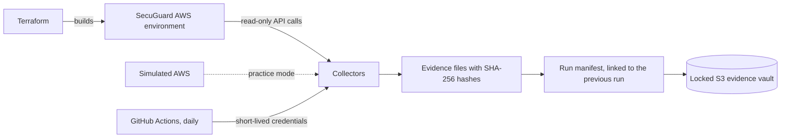

# SecuGuard GRC Engineering

Automated, tamper-evident compliance evidence for PCI DSS, SOC 2, and FedRAMP 20x, collected from a real AWS environment.

SecuGuard is a fictional card-issuing software company invented for this project. It is not a real business.

**New here? Read [MANUAL.md](MANUAL.md).** It walks through everything from a Windows computer with nothing installed to a working system, in plain language.

## The problem this solves

Most compliance evidence is still a screenshot in a folder. A screenshot is out of date the day it is taken, nothing proves it is real, and the same setting gets captured again for every framework that asks about it.

This project gathers evidence the way an engineer would:

| The old way | This project |
|---|---|
| Screenshots taken once a year | Evidence collected from AWS every day |
| Nothing proves a screenshot is unaltered | Every file is hashed, and every run is linked to the one before it |
| Evidence sits in a shared drive anyone can edit | The copy of record is in S3 with Object Lock and cannot be changed or deleted |
| One spreadsheet per framework | Each piece of evidence names the PCI DSS, SOC 2, and FedRAMP 20x requirements it supports |
| Someone has to remember to do it | A scheduled job does it, with no stored AWS keys |

## How it works



## Try it in two minutes

No AWS account needed. Practice mode runs the same collectors against a simulated AWS on your own machine.

```
pip install -e ".[dev]"
secuguard collect --mock
secuguard verify
```

Then edit any file under `evidence/` and run `secuguard verify` again to watch the change get caught. A finished run is in [examples/sample-run](examples/sample-run) if you only want to look.

## What is built so far

Stage 1, the foundation:

- A Terraform-built network with three zones tagged by PCI scope: cardholder data environment, connected, and out of scope
- Collectors for network segmentation, encryption keys, storage protections, and account sign-in settings
- Every piece of evidence labelled with the PCI DSS requirements, SOC 2 criteria, and FedRAMP 20x Key Security Indicators it supports
- Hashed evidence records, run manifests, and a hash chain across runs
- An encrypted, versioned S3 evidence vault with Object Lock
- Practice mode
- Daily collection from GitHub Actions using OpenID Connect

## Roadmap

| Stage | Adds |
|---|---|
| 2 | Certificate and cryptography posture checks |
| 3 | PCI scope drift detection and a preventive check on Terraform changes |
| 4 | FedRAMP 20x Key Security Indicator validation |
| 5 | Readable report, diagrams, and video walkthrough |

## Cost

Stage 1 costs about one dollar a month in AWS. `terraform destroy` removes all of it.
