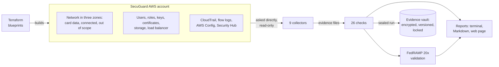
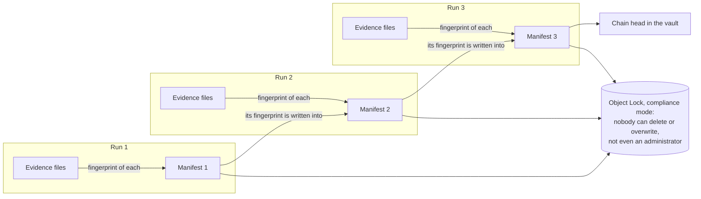
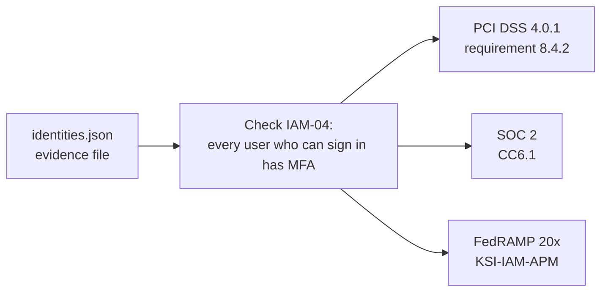
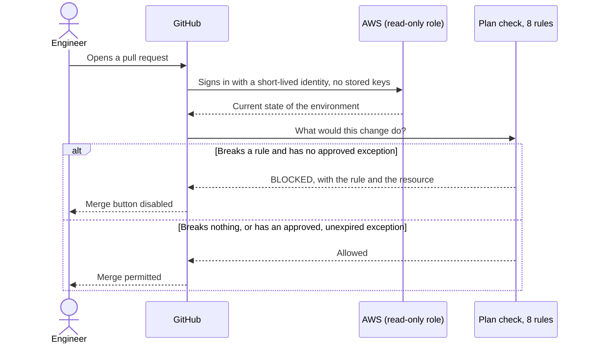

# How SecuGuard's evidence system fits together

Four pictures, each answering one question. GitHub draws them from the text in this file, so they stay in step with the project.

SecuGuard is a fictional company invented for this project.

## 1. What are the parts?

Terraform builds the environment. Collectors read it. Checks grade what the collectors wrote down. Everything is sealed and stored where it cannot be changed.

## 2. Why can the evidence be trusted?

Every file gets a fingerprint. The fingerprints go in a manifest. Each manifest records the fingerprint of the manifest before it, so the runs form a chain. Change any file in any run and the chain no longer adds up.

## 3. How does one check answer three frameworks?

A check is written once, against the evidence. It carries a list of the requirements it speaks to in each framework. The reports are three views of one set of results.

## 4. How is a risky change stopped?

Nobody can change the main branch directly. A change is proposed as a pull request. GitHub signs in to AWS with a short-lived, read-only identity, asks Terraform what the change would do, and judges the answer against eight rules. A change that breaks a rule cannot be merged.

## What runs where

| Thing | Where it runs | What it is allowed to do |
|---|---|---|
| Collectors, on your computer | Your computer, signed in through IAM Identity Center | Read configuration, write to the evidence vault |
| Collectors, daily | GitHub Actions, role `secuguard-evidence-collector` | Read configuration, write to the evidence vault. Usable only from the main branch. |
| Plan check on pull requests | GitHub Actions, role `secuguard-plan-checker` | Read only. Cannot change anything. Usable only from pull requests. |
| Terraform apply | Your computer | Build and change the environment |
